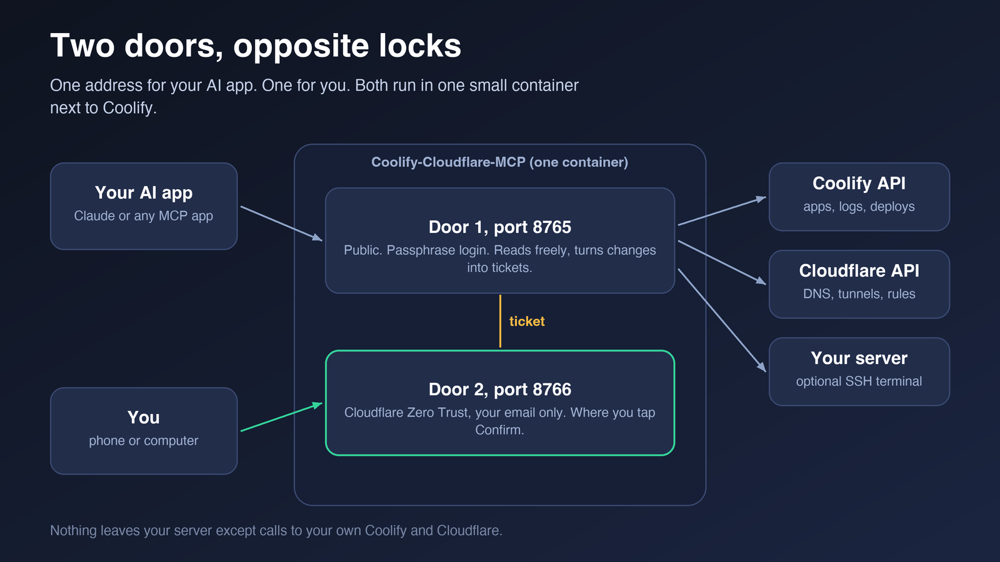

# How it works

For when you want to know what happens inside.

## The pieces

<p align="center"></p>

- **Your AI app.** Asks questions and asks for changes.
- **Door 1 (port 8765).** The MCP server. It answers read questions and turns change requests into tickets. Public, with a passphrase login.
- **Door 2 (port 8766).** The Confirm page. Behind Cloudflare Zero Trust. Only you can tap Confirm here.
- **Coolify and Cloudflare.** Reached over their own APIs, with tokens only this server holds.
- **The server (optional).** Reached over SSH for the terminal and the number checks.

```
AI app ──► Door 1 ──► Coolify / Cloudflare / SSH
              │
              └─► ticket ◄── you, on Door 2
```

## Two doors, one process

Both doors run in one small container. They are two addresses because they need opposite locks: Claude's door must be reachable by the AI app, the Confirm page must be reachable only by you.

## What happens when you ask to look

1. You ask your AI a question. It calls a read tool, like `coolify_overview`.
2. The server checks the arguments, calls Coolify or Cloudflare with the read token, and keeps only a short list of fields.
3. Secrets are hidden, lengths are capped, and the answer is wrapped as "data, not instructions".
4. The AI answers you.

## A change, step by step

1. The AI calls a change tool, for example `coolify_deploy`.
2. The server checks the arguments against strict patterns, and writes the ticket text itself. It hashes the checked arguments.
3. If changes are frozen or `READ_ONLY` is on, the request is refused with the Confirm link.
4. Otherwise the tool waits (45 seconds by default) for your tap.
5. You open the Confirm page, read the ticket and tap **Confirm** (or **Deny**). Deletes and tunnel routes also need a typed word.
6. The server checks the hash again, runs the change once, and writes a line to the action log.
7. If the tap came late, the AI calls `ops_result` and the change runs then, once.

There is no undo button. Many changes can be reversed by hand (roll back a deploy, delete a record), and Coolify and Cloudflare keep their own histories.

## What's stored

| What | Where | Who can read it |
|---|---|---|
| Login records of AI apps (fingerprints, not tokens) | `/data` volume | Whoever controls the server |
| The action log | `/data` volume | Whoever controls the server; no secret values in it |
| The freeze flag | `/data` volume | Whoever controls the server |
| Open tickets | Memory only | Lost on restart, which is safe |
| Your tokens and SSH key | Environment variables in Coolify | Whoever can open Coolify |

## The code

```
src/opsmcp/server.py       tools and entry point
src/opsmcp/consent.py      tickets and the double consent
src/opsmcp/confirm_app.py  the Confirm page
src/opsmcp/coolify.py      src/opsmcp/cloudflare.py   src/opsmcp/terminal.py
```

To change the code, read [AGENTS.md](../AGENTS.md).

**What next:** [Safety](safety.md) · [Every tool](tools.md)
